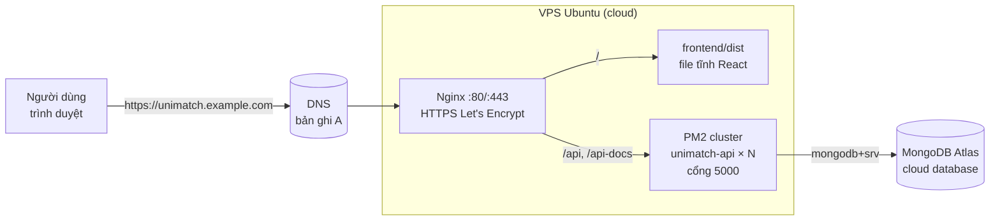

# Triển khai UniMatch HCMC (domain · DNS · web server · API server · PM2 · cloud)

Tài liệu này hướng dẫn đưa hệ thống lên một **máy chủ Linux trên cloud** với tên miền riêng, HTTPS,
Nginx làm web server và PM2 quản lý tiến trình API. Cuối tài liệu có phương án Vercel (đang có sẵn trong repo).

## 1. Kiến trúc



| Thành phần | Công nghệ | Vai trò |
|---|---|---|
| Domain + DNS | Nhà cung cấp tên miền (Namecheap, Tenten, Mắt Bão…) | Trỏ tên miền về IP của VPS |
| Cloud server | VPS Ubuntu 22.04/24.04 (Azure for Students, AWS EC2, Google Cloud, DigitalOcean…) | Chạy Nginx + API |
| Web server | **Nginx** (`deploy/nginx/unimatch.conf`) | Phục vụ frontend, reverse proxy `/api` về backend, HTTPS, gzip, cache |
| API server | **Node.js + Express**, quản lý bằng **PM2** (`process.json`) | Chạy nhiều instance, tự restart, tự khởi động cùng máy |
| Database | **MongoDB Atlas** | Dữ liệu dùng chung, không cần cài DB trên VPS |
| Tài liệu API | **apidoc**, phục vụ tại `/api-docs` | Công khai cùng địa chỉ backend |

> Sinh viên có thể nhận miễn phí: **GitHub Student Developer Pack** (tên miền `.me` / `.tech` 1 năm, credit DigitalOcean / Azure)
> và **Azure for Students** (credit dùng cho VPS) bằng email trường.

## 2. Tên miền và DNS

Tại trang quản lý DNS của tên miền, tạo 2 bản ghi trỏ về **IP công khai của VPS**:

| Loại | Tên (Host) | Giá trị | TTL |
|---|---|---|---|
| A | `@` | `<IP VPS>` | 300 |
| A | `www` | `<IP VPS>` | 300 |

Kiểm tra (đợi vài phút đến vài giờ để DNS lan truyền): `nslookup unimatch.example.com` phải ra đúng IP VPS.

## 3. Cài đặt máy chủ (một lần)

```bash
# Cập nhật hệ thống + công cụ cơ bản
sudo apt update && sudo apt upgrade -y
sudo apt install -y git nginx

# Node.js 24 LTS
curl -fsSL https://deb.nodesource.com/setup_24.x | sudo -E bash -
sudo apt install -y nodejs

# PM2 cài GLOBAL (dùng chung cho mọi project Node trên máy) — theo yêu cầu môn học
sudo npm install -g pm2

# Tường lửa: chỉ mở SSH + HTTP/HTTPS
sudo ufw allow OpenSSH
sudo ufw allow 'Nginx Full'
sudo ufw enable
```

**MongoDB Atlas:** vào *Network Access* → *Add IP Address* → thêm IP của VPS (nếu không backend sẽ không kết nối được DB).

## 4. Lấy code và cấu hình

```bash
cd ~
git clone https://github.com/24521912-source/university-finder.git   # repo private: đăng nhập bằng token / deploy key
cd university-finder

# Backend: biến môi trường bí mật KHÔNG nằm trong git
cp backend/.env.example backend/.env
nano backend/.env          # điền MONGODB_URI, MONGODB_DB_NAME, JWT_SECRET (chuỗi ngẫu nhiên dài)

cd backend
npm ci                     # cài đúng phiên bản trong package-lock.json
npm run docs               # tạo tài liệu API -> backend/public/api-docs
cd ../frontend
npm ci
VITE_API_URL=/api npm run build   # frontend gọi API cùng tên miền qua Nginx -> không lo CORS
cd ..
```

## 5. Chạy API bằng PM2

File **`process.json`** (thư mục gốc repo) khai báo **nhiều app trong một file**, mỗi app có biến môi trường riêng:

| App | Chạy gì | Ghi chú |
|---|---|---|
| `unimatch-api` | `backend/src/server.js` | `exec_mode: cluster`, `instances: 2` → 2 tiến trình chia tải trên nhiều nhân CPU; `max_memory_restart: 300M` tự restart nếu rò rỉ RAM; `env` / `env_production` |
| `unimatch-web` | Tính năng `serve` có sẵn của PM2, phục vụ `frontend/dist` ở cổng 8080 | Dùng khi **không** có Nginx (demo nhanh). Có Nginx thì không cần app này |

Biến bí mật (`MONGODB_URI`, `JWT_SECRET`) **không** ghi vào `process.json`, mà `server.js` tự đọc từ `backend/.env`
(PM2 chạy app với `cwd: ./backend`).

```bash
# Chạy tại THƯ MỤC GỐC repo (đường dẫn trong process.json tính từ đây)
pm2 start process.json --only unimatch-api --env production

pm2 status                 # trạng thái từng tiến trình: online / errored, số lần restart, CPU, RAM
pm2 monit                  # bảng theo dõi CPU / RAM thời gian thực
pm2 logs unimatch-api      # xem log (lỗi kết nối DB, request lỗi...)
curl http://localhost:5000/api/health
```

### Tự khởi động lại cùng máy chủ (mất điện, reboot)

```bash
pm2 save                   # lưu danh sách app đang chạy
pm2 startup systemd        # in ra 1 lệnh "sudo env PATH=... pm2 startup ..." -> copy và chạy lệnh đó
sudo reboot                # thử: sau khi máy bật lại, `pm2 status` vẫn thấy unimatch-api online
```

Từ đây API **không phụ thuộc cửa sổ terminal** (đóng SSH vẫn chạy), tự restart khi crash và tự chạy lại khi máy khởi động.

### Instances và cluster (mở rộng)

- **Nhiều instance trên 1 server:** đổi `"instances": 2` thành `"max"` (bằng số nhân CPU) → `pm2 reload unimatch-api`. PM2 tự chia request cho các tiến trình.
- **Nhiều server (cụm máy):** chạy cùng `process.json` trên server B, C…, rồi thêm IP của chúng vào khối `upstream unimatch_api` trong `deploy/nginx/unimatch.conf`. Nginx sẽ chia tải cho cả cụm.
- Backend **không lưu trạng thái trong RAM** (đăng nhập bằng JWT, dữ liệu ở Atlas) nên chạy nhiều tiến trình / nhiều máy không bị lệch dữ liệu.

## 6. Nginx (web server + reverse proxy)

```bash
# Sửa tên miền và đường dẫn code trong file trước khi copy
sudo cp deploy/nginx/unimatch.conf /etc/nginx/sites-available/unimatch
sudo ln -s /etc/nginx/sites-available/unimatch /etc/nginx/sites-enabled/
sudo rm -f /etc/nginx/sites-enabled/default
sudo nginx -t && sudo systemctl reload nginx
```

Nginx: phục vụ file tĩnh React (có fallback `index.html` cho React Router), chuyển `/api` và `/api-docs` về PM2, nén gzip, cache file `assets/`.

## 7. HTTPS (Let's Encrypt)

```bash
sudo apt install -y certbot python3-certbot-nginx
sudo certbot --nginx -d unimatch.example.com -d www.unimatch.example.com
```

Certbot tự cấu hình HTTPS, chuyển HTTP → HTTPS và tự gia hạn chứng chỉ (`systemctl list-timers | grep certbot`).

## 8. Cập nhật phiên bản mới

```bash
cd ~/university-finder
git pull
cd backend && npm ci && npm run docs && cd ..
cd frontend && npm ci && VITE_API_URL=/api npm run build && cd ..
pm2 reload unimatch-api    # cluster mode: restart lần lượt từng tiến trình -> không gián đoạn (zero-downtime)
```

## 9. Phương án khác: Vercel (đã cấu hình sẵn)

- `backend/vercel.json`: chạy Express như serverless function, build tài liệu API (`npm run docs`) và đóng gói thư mục `public/` → tài liệu có ở `https://<backend>.vercel.app/api-docs`.
- `frontend/vercel.json`: SPA fallback. Đặt biến `VITE_API_URL=https://<backend>.vercel.app/api` trong Vercel.
- Vercel không dùng PM2 (nền tảng tự quản lý tiến trình), nên để đạt yêu cầu PM2 của môn học, dùng phương án VPS ở trên.

## 10. Checklist nghiệm thu triển khai

- [ ] `nslookup <tên miền>` ra IP VPS
- [ ] `https://<tên miền>` mở được trang chủ, có ổ khóa HTTPS
- [ ] `https://<tên miền>/truong/cong-nghe-thong-tin-dhqg` (vào thẳng link con) không lỗi 404
- [ ] `https://<tên miền>/api/health` trả `{"status":"OK"}`
- [ ] `https://<tên miền>/api-docs/` mở được tài liệu API
- [ ] `pm2 status` thấy `unimatch-api` 2 tiến trình `online`
- [ ] `sudo reboot` xong, API tự chạy lại
