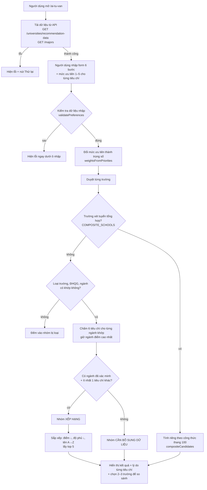

# Thiết kế luồng xử lý AI tư vấn (WBS 2.4)

- **Phụ trách:** Tú · **Ưu tiên:** P0
- **Phạm vi:** mô tả luồng dữ liệu và quy tắc chấm điểm của trang `/ai-tu-van`, đúng với code hiện có
  (`frontend/src/features/recommendations/*`, `pages/AI/AI.jsx`, `components/RecommendationResults.jsx`).

> "AI tư vấn" ở đây là **hệ gợi ý dựa trên quy tắc có thể giải thích** (rule-based), không phải mô hình học máy.
> Điểm phù hợp **không phải** xác suất trúng tuyển.

---

## 1. Tổng quan luồng



## 2. Dữ liệu đầu vào

### 2.1. Dữ liệu người dùng nhập (form 6 bước)

| Bước | Trường dữ liệu | Giá trị hợp lệ | Ghi chú |
|---|---|---|---|
| 1 | Ngành / nhóm ngành (`majorCodes`) | Chọn từ ô gợi ý (`MajorPicker`) | Gõ không dấu, viết tắt (IT, QTKD) vẫn tìm được. Bắt buộc |
| 2 | Phương thức (`method`) | `high_school_exam` (thang 30) hoặc `competency_assessment` (ĐGNL, thang 1200) | |
| 2 | Tổ hợp (`combination`) + điểm 3 môn | Tổ hợp trong `COMBINATIONS`, mỗi môn 0–10 | Chỉ với THPT. Tổng điểm tự cộng, chưa gồm điểm cộng / ưu tiên |
| 2 | Điểm ĐGNL (`score`) | 0–1200 | Chỉ với ĐGNL |
| 3 | Trần học phí (`budget`) | Số dương (đồng/năm) hoặc `any` | |
| 4 | Khu vực (`district`) | Quận có trong dữ liệu hoặc `any` | |
| 5 | Loại trường (`institutionType`) | `public` / `private` / `any` | Là **bộ lọc cứng** |
| 6 | ĐHQG-HCM (`vnuhcm`) | `only` / `exclude` / `any` | Là **bộ lọc cứng** |

Mỗi tiêu chí có **mức ưu tiên** 1–5 (1 = quan trọng nhất) hoặc "Không quan tâm".

### 2.2. Dữ liệu hệ thống (MongoDB, admin sửa được ở `/admin`)

- `universities`: `majors[]`, `tuition[]`, `admissions[]`, `address.district`, `sourceDomains[]`.
- Chỉ dùng dữ liệu **đã xác minh**:
  - Ngành được tin khi có bản ghi học phí / điểm chuẩn cùng mã ngành, link nguồn thuộc tên miền chính thức của trường (`sourceDomains`).
  - Điểm chuẩn chỉ được so khi admin bật `verifiedForAI = true`, đúng phương thức, đúng năm `ADMISSION_YEAR` (2026), đúng thang điểm.
  - Học phí chỉ dùng mức **theo năm**, năm học `ACADEMIC_YEAR` (2026–2027), chương trình chuẩn. Không quy đổi từ học kỳ / tín chỉ / trọn khóa.

## 3. Quy tắc chấm điểm

### 3.1. Trọng số từ mức ưu tiên

| Mức ưu tiên | 1 | 2 | 3 | 4 | 5 | Không quan tâm |
|---|---|---|---|---|---|---|
| Trọng số | 1 | 0,75 | 0,55 | 0,4 | 0,3 | 0 (bỏ qua) |

Tiêu chí "Ngành" luôn phải có trọng số > 0.

### 3.2. Điểm từng tiêu chí (thang 0–100)

| Tiêu chí | Cách tính | Khi thiếu dữ liệu |
|---|---|---|
| Ngành phù hợp | 100 nếu trường có mã ngành đã xác minh | Trường vào nhóm "Cần bổ sung dữ liệu" |
| Điểm tham chiếu | `50 + 500 × (điểm nhập − điểm chuẩn) / thang điểm`, giới hạn 0–100 | Bỏ khỏi mẫu số |
| Học phí | `min(100, 100 × ngân sách / học phí tối đa)`; miễn học phí = 100 | Bỏ khỏi mẫu số |
| Khu vực | Đúng quận trụ sở = 100, khác quận = 0 | Bỏ khỏi mẫu số |
| Chất lượng / xếp hạng | Chưa có dữ liệu kiểm chứng | Luôn bỏ khỏi mẫu số |
| Học bổng | Chưa có dữ liệu kiểm chứng | Luôn bỏ khỏi mẫu số |

### 3.3. Điểm tổng và độ phủ

```text
Điểm tổng = Σ (điểm tiêu chí × trọng số) / Σ trọng số của các tiêu chí CÓ dữ liệu
Độ phủ    = Σ trọng số có dữ liệu / Σ trọng số ban đầu × 100%
```

- Dữ liệu thiếu **không bị gán 0**, mà được loại khỏi mẫu số. Độ phủ cho người dùng biết kết quả dựa trên bao nhiêu dữ liệu.
- Chỉ xếp hạng khi có tiêu chí Ngành **và ít nhất một tiêu chí khác**.
- Với nhóm ngành (nhiều mã ngành), mỗi trường được chấm cho từng ngành khớp và giữ ngành có điểm cao nhất làm đại diện. Các ngành còn lại hiện ở "ngành liên quan".
- Sắp xếp: điểm tổng giảm dần → độ phủ giảm dần → tên trường A→Z. Hiển thị top 5.

### 3.4. Trường xét tuyển tổng hợp (thang 100)

Bách khoa (HCMUT), Kinh tế - Luật (UEL) và KHXH&NV (USSH) dùng công thức riêng: ĐGNL + THPT + học bạ + điểm cộng + ưu tiên.
Các trường này **không xếp chung** với bảng trên mà có mục riêng:

1. Lấy điểm chuẩn thang 100 năm 2026 đã xác minh của các ngành người dùng chọn.
2. Ước tính sơ bộ từ 3 môn: giả định không có ĐGNL, học bạ bằng điểm thi, không có điểm cộng / ưu tiên.
3. Gắn nhãn: **Khả thi** (≥ điểm chuẩn), **Cần cân nhắc** (thiếu dưới 5 điểm), **Khó**.
4. Người dùng mở **máy tính chi tiết** (`CompositeCalculator`) để nhập đủ ĐGNL, học bạ, điểm cộng.

## 4. Đầu ra

`recommend()` trả về:

```js
{
  ranked: [/* top 5 */ { slug, name, major, score, coverage, evaluatedCount, criteria: { major, admission, tuition, geography, quality, scholarship } }],
  rankedCount,   // tổng số trường đủ điều kiện xếp hạng
  needsData: [], // trường khớp ngành nhưng thiếu dữ liệu, kèm lý do
  excluded,      // số trường bị loại do không khớp ngành / loại trường / ĐHQG
  composite: [], // trường xét tuyển tổng hợp
}
```

Mỗi tiêu chí có `{ score, text, source }`: `text` là **lý do đề xuất** hiện cho người dùng, `source` là link nguồn chính thức.

Trên giao diện kết quả (WBS 4.8, `RecommendationResults`):

- Thẻ từng trường: thứ hạng, điểm phù hợp, độ phủ, ngành phù hợp, lý do từng tiêu chí kèm link nguồn.
- Chọn 2–3 trường → **So sánh** (`/so-sanh`, chế độ so sánh kết quả AI).
- Nhóm "Cần bổ sung dữ liệu" và nhóm "Xét tuyển tổng hợp" hiện riêng.

## 5. Nguyên tắc thiết kế

1. **Giải thích được:** mỗi điểm số đều có câu lý do và link nguồn.
2. **Không bịa dữ liệu:** thiếu thì nói thiếu, không gán 0, không quy đổi đơn vị học phí hay thang điểm.
3. **Admin kiểm soát dữ liệu AI:** chỉ dòng điểm chuẩn có `verifiedForAI = true` mới được dùng để so điểm.
4. **Chạy ở frontend:** dữ liệu tải một lần, mỗi lần bấm "Tư vấn" chấm điểm ngay, không cần gọi API thêm.

## 6. Việc còn mở

- Lưu lịch sử tư vấn (WBS 5.10, 6.7): đã có model `Consultation` ở backend nhưng chưa có API và giao diện.
- Tiêu chí Chất lượng và Học bổng chưa có dữ liệu kiểm chứng nên đang luôn bị bỏ qua.
